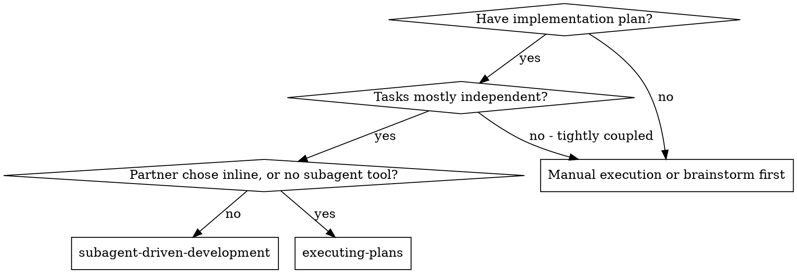

# Subagent-Driven Development

Execute plan by dispatching a fresh implementer subagent per task, a task review (spec compliance + code quality) after each, and a broad whole-branch review at the end.

**Why subagents:** Each task goes to an agent with isolated context and exactly the instructions and context you construct for it — never your session's history — so it stays focused, and your own context stays free for coordination.

**Core principle:** Fresh subagent per task + task review (spec + quality) + broad final review = high quality, fast iteration

**Narration:** between tool calls, at most one short line — the ledger
and the tool results carry the record.

**Continuous execution:** Do not pause to check in with your human partner between tasks. Execute all tasks without stopping; the only reasons to stop are the four below, or all tasks complete. "Should I continue?" prompts and progress summaries waste their time — they asked you to execute the plan, so execute it.

**Rulings, not stalls.** A running plan does not wait on a human. Conflicts,
ambiguities, plan defects, a cap you would have asked to exceed — decide
them. The spec is the binding authority, the plan is its argument, and your
judgment settles what neither answers. Record every decision in the ledger as
`Ruling: <what you decided> — <why> — <what it costs if wrong>`, and keep
going. A wrong ruling costs rework your human partner can see and undo; a
session parked on a question costs their whole day and buys nothing.

Four things stop you, and only these: an irreversible or destructive
operation; a security-sensitive action; a side effect outside this worktree
that norms say you ask about first (a merge, a push to a shared branch, a
publish); and a plan so broken that every path forward is a guess. For those,
stop and ask.

## When to Use



**vs. Executing Plans (inline):**
- Fresh subagent per task (no context pollution) and a review after each (spec compliance + code quality); inline does every task in one context and reviews only at the end
- Costs a fresh context per task and per review; inline costs one context plus one final reviewer
- Both run in this session, share the same plan workspace and ledger, and never pause between tasks

## Setup

Work in an isolated workspace: superpowers:using-git-worktrees creates or
verifies one. Never start implementation on a main/master branch without
your human partner's explicit consent.

Conversation memory does not survive compaction. In real sessions,
controllers that lost their place have re-dispatched entire completed task
sequences — the single most expensive failure observed. Track progress in
a ledger file, not only in todos.

- Each plan owns a workspace: at skill start, run this skill's
  `bash scripts/sdd-workspace PLAN_FILE` — it prints the plan's git-ignored
  directory (under `<repo-root>/.superpowers/sdd/`), home to every artifact
  for THIS plan: ledger, briefs, reports, review packages. Another plan's
  directory is never yours to read or write. `git clean -fdx` destroys
  this git-ignored scratch; if that happens, recover from `git log`.
- If `<workspace>/progress.md` exists, read
  [references/resuming.md](references/resuming.md) before anything else:
  it says whose ledger it is and where to resume. Otherwise create the
  ledger with its identity as the first line:
  `# SDD ledger — plan: <plan file path>`.
- The ledger is your recovery map: its commits exist in git even when you
  no longer remember creating them. After compaction, trust the ledger and
  `git log` over your recollection.

Read the plan once, note its context and Global Constraints, and create a
todo per task. If the plan names a Spec, read that too: the spec is the
authority the plan argues from, and conflicts inside the plan resolve
against it. A plan with no reachable spec gets a ledger note saying so —
rulings made without one are provisional.

Before dispatching Task 1, read [references/preflight.md](references/preflight.md)
and run the conflict scan it describes. Its table and rulings go in the
ledger.

## Model Selection

Use the least powerful model that can handle each role. **Always specify the model explicitly when dispatching a subagent:** an omitted model inherits your session's model — often the most capable and most expensive — which silently defeats this section.

| Role | Model |
|------|-------|
| Implementer whose plan text contains the complete code; single-file mechanical fix | cheapest tier |
| Implementer working from prose; task reviewer; scoped re-review of a fix | mid tier — the floor, because the cheapest models take 2-3× the turns on multi-step work and cost more overall |
| Multi-file integration, debugging, pattern matching | standard tier |
| Design judgment or broad codebase understanding; the final whole-branch review | most capable available, not the session default |
| Fix-loop rounds 4-5 | at least one tier above the implementer that got stuck |

Scale a task reviewer to the diff's size, complexity, and risk: a small mechanical diff stays at mid tier; a subtle concurrency change goes higher.

## The Task Loop

**Small same-shape work:** when the plan lists several small edits of the
same kind across files, read [references/batching.md](references/batching.md)
before dispatching them.

Everything you paste into a dispatch prompt — and everything a subagent
prints back — stays resident in your context for the rest of the session
and is re-read on every later turn. Hand artifacts over as files.

**Waiting on dispatched subagents:** never poll a wait interface with
short timeouts, and never sit in one silent, open-ended wait. While you
have local work — ledger updates, packaging the next review, reading
reports — keep working; child results arrive on their own. When genuinely
idle, wait in bounded stretches (five to ten minutes, where your platform
allows); between stretches post one line of status and reconcile your
live children: list them, and chase any that finished without reporting.

### 1. Dispatch the implementer

Record BASE (`git rev-parse HEAD`) before dispatching — the review package
and fix-round diffs need it.

- **Task brief:** run this skill's `bash scripts/task-brief PLAN_FILE N` —
  it extracts the task's full text to a uniquely named file and prints the
  path. The brief stays the single source of requirements: exact values
  (numbers, magic strings, signatures, test cases) appear only there.
  Never make a subagent read the whole plan file.
- **What the dispatch carries:** (1) one line on where this task fits in
  the project; (2) the brief path, introduced as "read this first — it is
  your requirements, with the exact values to use verbatim"; (3)
  interfaces and decisions from earlier tasks that the brief cannot know;
  (4) your resolution of any ambiguity you noticed in the brief; (5) the
  report-file path and report contract. If an earlier task parked a
  finding in the area this task touches, add a pointer to that ledger
  entry.
- **Report file:** name it after the brief (`…/task-N-brief.md` →
  `…/task-N-report.md`). The implementer writes the full report there and
  returns only status, commits, a one-line test summary, and concerns.
- A dispatch describes one task, not the session's history. Never paste
  accumulated prior-task summaries ("state after Tasks 1-3") — a real
  session's dispatch hit 42k chars, 99% of it pasted history. A fresh
  subagent needs its task, the interfaces it touches, and the global
  constraints. Nothing else.
- The implementer never dispatches subagents — not helpers, and never a
  reviewer (the no-subagents contract is in its template). Review arrives
  from you, after the report; a reviewer a worker spawns only duplicates
  that seat at full cost.
- Record the implementer's agent identity from the dispatch result —
  fix-loop rounds 1-3 resume this agent.
- Never dispatch multiple implementation subagents in parallel (conflicts).

**Dispatch prompt** (the whole prompt; the instructions live in [implementer-prompt.md](implementer-prompt.md), which the implementer reads itself — never paste it). `<skill-dir>` is this skill's directory as an absolute path:

```
You are the implementer for [TASK].
Read <skill-dir>/implementer-prompt.md and follow it. Your values:
- BRIEF_FILE: <path task-brief printed>
- REPORT_FILE: <brief path with -brief replaced by -report>
- WORKDIR: <directory>
- CONTEXT: <items (1), (3), (4) above, and any parked-finding pointer>
```

Use this exact prompt shape for every task's dispatch, not only the first: a hand-written summary of the template drops rules the subagent needs.

### 2. Handle the report

Implementers report one of four statuses.

**DONE:** review the task (step 3).

**Any other status** (DONE_WITH_CONCERNS, NEEDS_CONTEXT, BLOCKED): read
[references/handling-reports.md](references/handling-reports.md) and follow
it, every time you get one.

If the implementer asks questions — before starting or mid-task — answer
clearly and completely, with extra context if needed; don't rush it into
implementation.

### 3. Review the task

Per-task reviews are task-scoped gates; the broad review happens once, at
the end. Never skip the task review, and never
accept a report missing either verdict — spec compliance AND task quality
are both required. Implementer self-review never replaces the task
review; both are needed.

- **Diff as a file:** run this skill's
  `bash scripts/review-package PLAN_FILE BASE HEAD` and pass the reviewer
  the unique path it prints (without bash: `git log --oneline`,
  `git diff --stat`, and `git diff -U10` for the range, redirected to one
  uniquely named file). BASE is the commit you recorded before
  dispatching the implementer — never `HEAD~1`, which silently drops all
  but the last commit of a multi-commit task. The package stays out of
  your context; the reviewer reads it in one call. Never dispatch a task
  reviewer without a diff file.
- **Reviewer inputs:** three paths — the same brief file, the report file,
  and the review package — plus the global constraints that bind the task.
- The global-constraints block is the reviewer's attention lens. Copy the
  binding requirements verbatim from the plan's Global Constraints section
  or the spec: exact values, exact formats, and the stated relationships
  between components ("same layout as X", "matches Y"). The process rules
  (YAGNI, test hygiene, review method) are already in the reviewer's
  template.
- No open-ended directives like "check all uses" or "run race tests if
  useful" without a concrete, task-specific reason. Do not ask a reviewer
  to re-run tests the implementer already ran on the same code — the
  report carries the test evidence.
- Do not pre-judge findings — never instruct a reviewer to ignore or not
  flag a specific issue. If you believe a finding would be a false
  positive, let the reviewer raise it and adjudicate it in the review
  loop. If the prompt you are writing contains "do not flag," "don't treat
  X as a defect," "at most Minor," or "the plan chose" — stop: you are
  pre-judging, usually to spare yourself a review loop.

If the reviewer reports "⚠️ Cannot verify from diff" items, read
[references/cannot-verify.md](references/cannot-verify.md) before you mark
the task complete.

**Dispatch prompt** (the reviewer reads [task-reviewer-prompt.md](task-reviewer-prompt.md) itself — never paste it):

```
You are the task reviewer for [TASK].
Read <skill-dir>/task-reviewer-prompt.md and follow it. Your values:
- BRIEF_FILE, REPORT_FILE, DIFF_FILE: <paths>
- BASE_SHA, HEAD_SHA: <commits>
- GLOBAL_CONSTRAINTS: <copied verbatim, as above>
```

Same for every review dispatch.

### 4. The fix loop

The loop triggers when the review reports spec ❌, any Critical or Important
finding, or a ⚠️ item you confirmed as a real gap.

When it triggers, read [references/fix-loop.md](references/fix-loop.md) and
follow it. Read it again before every round, even if you read it earlier in
this session: it holds the round cap, the breaker, and the ledger line each
round writes, and your memory of it does not survive compaction.

### 5. Complete the task

When the review comes back clean — or every open finding is parked with a
ruling at the cap — append the completion line to the ledger in the same
message as your other bookkeeping:

- `Task <N>: complete (commits <base7>..<head7>, review clean)`
- `Task <N>: complete (commits <base7>..<head7>, <K> parked)` after a
  tripped breaker

Then mark the todo complete and move on. Never move to the next task while
the review has open Critical/Important issues that are neither fixed nor
parked-with-ruling at the cap.

## Final Review

When every task is complete, read
[references/final-review.md](references/final-review.md) and follow it
(whole-branch review, single fix wave), then Finish.

## Finish

Before you delete anything, write your final message: one opening line
(tasks done, suite status, how many rulings you made); every ledger line
containing `Ruling:` — preflight rulings, parked findings, breaker
adjudications, all of them — under "Rulings I made", highest
cost-if-wrong first, each with what it costs if wrong; every
`minor (deferred)` line no fix addressed, under "Deferred minors". Both
lists are exhaustive. That message is the only place the decisions you
took on your human partner's behalf reach them — they read it and rework
whatever you got wrong. A ruling that dies with the workspace was a
decision made in secret.

When the final review is clean and its fixes are committed, delete this
plan's workspace (`rm -rf <workspace>`) — the git history is the record
now. Sibling directories belong to other plans; leave them alone.

Use superpowers:finishing-a-development-branch.

## Common Rationalizations

| Excuse | Reality |
|--------|---------|
| "Close enough on spec compliance" | Spec gaps = not done. Fix, or hit the cap and adjudicate — the only exits. |
| "I'll fix it myself, dispatching is overhead" | Controller fixes pollute your context and skip review. Resume the implementer. |
| "One more round will converge" | Past the cap, the failure is structural. Adjudicate and route. |
| "The reviewer will just find something new anyway" | Scoped re-reviews verify fixes; they cannot wander. New findings on untouched code go to the ledger, not the loop. |
| "This finding is obviously wrong, I'll drop it" | You rule only at the cap or on a plan-mandated finding (references/fix-loop.md), and every ruling is a ledger entry. Silent discards are forbidden. |
| "The fix was small, skip the re-review" | Unreviewed fixes are how regressions land. Every round ends with a scoped re-review. |
| "Reviews slow the loop down" | Without reviews the loop is unverified churn. |
| "Ledger bookkeeping is overhead" | The ledger is what survives compaction. Without it you re-dispatch finished tasks. |
| "The implementer spawned its own reviewer — free extra assurance" | A duplicate seat on the same diff; the task review is the gate. Flag it as a defect. |
