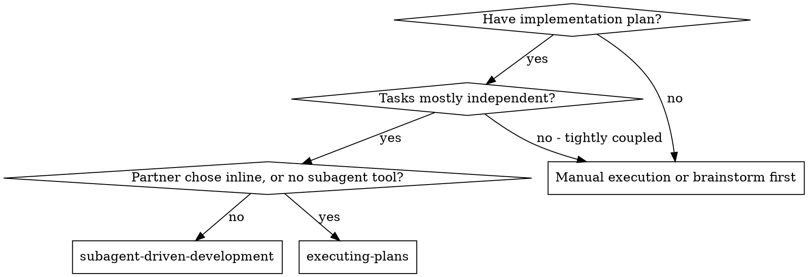

# Subagent-Driven Development

Execute plan by dispatching a fresh implementer subagent per task, a task review (spec compliance + code quality) after each, and a broad whole-branch review at the end.

**Why subagents:** You delegate tasks to specialized agents with isolated context. By precisely crafting their instructions and context, you ensure they stay focused and succeed at their task. They should never inherit your session's context or history — you construct exactly what they need. This also preserves your own context for coordination work.

**Core principle:** Fresh subagent per task + task review (spec + quality) + broad final review = high quality, fast iteration

**Read [references/execution-rules.md](references/execution-rules.md) now, and again after any compaction** — the rules this skill shares with executing-plans: continuous execution, rulings, the four things that stop you, narration, the ledger, Setup, and Finish.

## When to Use



**vs. Executing Plans (inline):**
- Fresh subagent per task (no context pollution) instead of one context doing every task
- Review after each task (spec compliance + code quality) instead of only at the end
- Costs a fresh context per task and per review; inline costs one context plus one final reviewer
- Both run in this session, share the same plan workspace and ledger, and never pause between tasks

## Setup

Run Setup from execution-rules.md (worktree, plan workspace, ledger, plan
and spec). Its pre-flight scan, under this skill, is
[references/preflight.md](references/preflight.md): read it before
dispatching Task 1; its table and rulings go in the ledger.

## Model Selection

Use the least powerful model that can handle each role. **Always specify the model explicitly when dispatching a subagent:** an omitted model inherits your session's model — often the most capable and most expensive — which silently defeats this section.

| Role | Model |
|------|-------|
| Implementer whose plan text contains the complete code; single-file mechanical fix | cheapest tier |
| Implementer working from prose; task reviewer; scoped re-review of a fix | mid tier — the floor, because the cheapest models take 2-3× the turns on multi-step work and cost more overall |
| Multi-file integration, debugging, pattern matching | standard tier |
| Design judgment or broad codebase understanding; the final whole-branch review | most capable available, not the session default |
| Fix-loop rounds 4-5 | at least one tier above the implementer that got stuck |

Scale a task reviewer to the diff's size, complexity, and risk: a small mechanical diff stays at mid tier; a subtle concurrency change goes higher.

## The Task Loop

**Small same-shape work:** when the plan lists several small edits of the
same kind across files, read [references/batching.md](references/batching.md)
before dispatching them.

**Waiting on dispatched subagents:** never poll a wait interface with
short timeouts, and never sit in one silent, open-ended wait either.
While you have local work — ledger updates, packaging the next review,
reading reports — keep working; child results arrive on their own. When
you are genuinely idle, wait in bounded stretches (five to ten minutes,
where your platform allows), and between stretches post one line of
status and reconcile your live children: list them, and chase any that
finished without reporting. A stuck or lost child is then noticed within
minutes, not at the end of the session.

### 1. Dispatch the implementer

Record BASE (`git rev-parse HEAD`) before dispatching — the review package
and fix-round diffs need it.

- **Task brief:** run this skill's `bash scripts/task-brief PLAN_FILE N` —
  it extracts the task's full text to a uniquely named file and prints the
  path. The brief stays the single source of requirements: exact values
  (numbers, magic strings, signatures, test cases) appear only there.
  Never make a subagent read the whole plan file.
- **What the dispatch carries:** (1) one line on where this task fits in
  the project; (2) the brief path, introduced as "read this first — it is
  your requirements, with the exact values to use verbatim"; (3)
  interfaces and decisions from earlier tasks that the brief cannot know;
  (4) your resolution of any ambiguity you noticed in the brief; (5) the
  report-file path and report contract. If an earlier task parked a
  finding in the area this task touches, add a pointer to that ledger
  entry.
- **Report file:** name it after the brief (`…/task-N-brief.md` →
  `…/task-N-report.md`). The implementer writes the full report there and
  returns only status, commits, a one-line test summary, and concerns.
- A dispatch describes one task, not the session's history. Never paste
  accumulated prior-task summaries ("state after Tasks 1-3") — a real
  session's dispatch hit 42k chars, 99% of it pasted history. A fresh
  subagent needs its task, the interfaces it touches, and the global
  constraints. Nothing else.
- The implementer never dispatches subagents — not helpers, and never a
  reviewer (the no-subagents contract is in its template). Review arrives
  from you, after the report. In real sessions, every reviewer a worker
  spawned duplicated the task review the controller dispatched anyway — a
  full extra review seat per task.
- Record the implementer's agent identity from the dispatch result —
  fix-loop rounds 1-3 resume this agent.
- Never dispatch multiple implementation subagents in parallel (conflicts).

**Dispatch prompt** (the whole prompt; the instructions live in [implementer-prompt.md](implementer-prompt.md), which the implementer reads itself — never paste it). `<skill-dir>` is this skill's directory as an absolute path:

```
You are the implementer for [TASK].
Read <skill-dir>/implementer-prompt.md and follow it. Your values:
- BRIEF_FILE: <path task-brief printed>
- REPORT_FILE: <brief path with -brief replaced by -report>
- WORKDIR: <directory>
- CONTEXT: <items (1), (3), (4) above, and any parked-finding pointer>
```

### 2. Handle the report

Implementer subagents report one of four statuses.

**DONE:** review the task (step 3).

**Any other status** (DONE_WITH_CONCERNS, NEEDS_CONTEXT, BLOCKED): read
[references/handling-reports.md](references/handling-reports.md) and follow
it, every time you get one.

If the implementer asks questions — before starting or mid-task — answer
clearly and completely, provide additional context if needed, and don't
rush it into implementation.

### 3. Review the task

Per-task reviews are task-scoped gates; the broad review happens once, at
the final whole-branch review. Never skip the task review, and never
accept a report missing either verdict — spec compliance AND task quality
are both required. Implementer self-review never replaces the task
review; both are needed.

- **Diff as a file:** run this skill's
  `bash scripts/review-package PLAN_FILE BASE HEAD` and pass the reviewer
  the unique path it prints (without bash: `git log --oneline`,
  `git diff --stat`, and `git diff -U10` for the range, redirected to one
  uniquely named file). BASE is the commit you recorded before
  dispatching the implementer — never `HEAD~1`, which silently drops all
  but the last commit of a multi-commit task. The package never enters
  your context; the reviewer reads the commit list, stat summary, and full
  diff in one Read call. Never dispatch a task reviewer without a diff
  file.
- **Reviewer inputs:** three paths — the same brief file, the report file,
  and the review package — plus the global constraints that bind the task.
- The global-constraints block is the reviewer's attention lens. Copy the
  binding requirements verbatim from the plan's Global Constraints section
  or the spec: exact values, exact formats, and the stated relationships
  between components ("same layout as X", "matches Y"). The process rules
  (YAGNI, test hygiene, review method) are already in the reviewer's
  template.
- No open-ended directives like "check all uses" or "run race tests if
  useful" without a concrete, task-specific reason. Do not ask a reviewer
  to re-run tests the implementer already ran on the same code — the
  report carries the test evidence.
- Do not pre-judge findings — never instruct a reviewer to ignore or not
  flag a specific issue. If you believe a finding would be a false
  positive, let the reviewer raise it and adjudicate it in the review
  loop. If the prompt you are writing contains "do not flag," "don't treat
  X as a defect," "at most Minor," or "the plan chose" — stop: you are
  pre-judging, usually to spare yourself a review loop.

If the reviewer reports "⚠️ Cannot verify from diff" items, read
[references/cannot-verify.md](references/cannot-verify.md) before you mark
the task complete.

**Dispatch prompt** (the reviewer reads [task-reviewer-prompt.md](task-reviewer-prompt.md) itself — never paste it):

```
You are the task reviewer for [TASK].
Read <skill-dir>/task-reviewer-prompt.md and follow it. Your values:
- BRIEF_FILE, REPORT_FILE, DIFF_FILE: <paths>
- BASE_SHA, HEAD_SHA: <commits>
- GLOBAL_CONSTRAINTS: <copied verbatim, as above>
```

### 4. The fix loop

The loop triggers when the review reports spec ❌, any Critical or Important
finding, or a ⚠️ item you confirmed as a real gap.

When it triggers, read [references/fix-loop.md](references/fix-loop.md) and
follow it. Read it again before every round, even if you read it earlier in
this session: it holds the round cap, the breaker, and the ledger line each
round writes, and your memory of it does not survive compaction.

### 5. Complete the task

When the review comes back clean — or every open finding is parked with a
ruling at the cap — append the completion line to the ledger with your
other bookkeeping:

- `Task <N>: complete (commits <base7>..<head7>, review clean)`
- `Task <N>: complete (commits <base7>..<head7>, <K> parked)` after a
  tripped breaker

Then mark the todo complete and move on. Never move to the next task while
the review has open Critical/Important issues that are neither fixed nor
parked-with-ruling at the cap.

## Final Review

When every task is complete, read
[references/final-review.md](references/final-review.md) and follow it. It
covers the whole-branch review, its single fix wave, and how you finish.

## Common Rationalizations

The rows on check-ins, unledgered deviations, and the ledger are in
execution-rules.md.

| Excuse | Reality |
|--------|---------|
| "Close enough on spec compliance" | Reviewer found spec gaps = not done. Fix or hit the cap and adjudicate — those are the only exits. |
| "I'll fix it myself, dispatching is overhead" | Controller fixes pollute your context and skip review. Resume the implementer. |
| "One more round will converge" | Past the cap, rounds don't converge — the failure is structural. Adjudicate and route. |
| "The reviewer will just find something new anyway" | Scoped re-reviews verify fixes; they cannot wander. New findings on untouched code go to the ledger, not the loop. |
| "This finding is obviously wrong, I'll drop it" | You rule only at the cap or on a plan-mandated finding (references/fix-loop.md), and every ruling is a ledger entry. Silent discards are forbidden. |
| "The fix was small, skip the re-review" | Unreviewed fixes are how regressions land. Every round ends with a scoped re-review. |
| "Reviews slow the loop down" | The loop without reviews is just unverified churn. Reviews are the loop's brakes and steering. |
| "The implementer spawned its own reviewer — free extra assurance" | It's a duplicate seat reviewing the same diff; the task review is the gate. A worker-spawned reviewer is a defect to flag, not rigor. |
